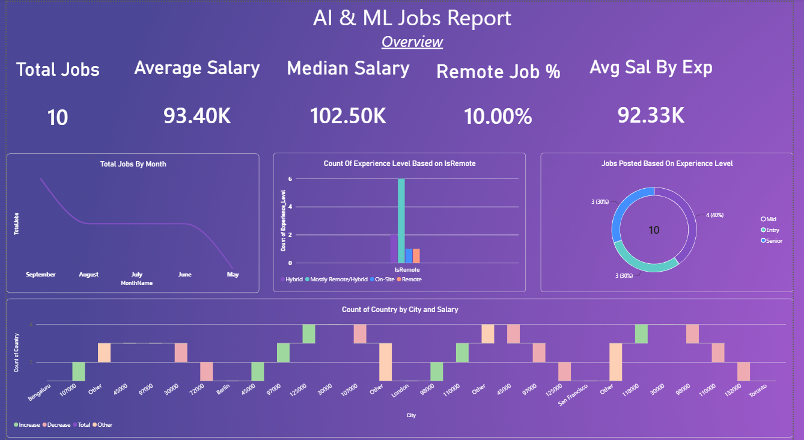

# AI & ML Job Market Analysis Dashboard | Power BI

## 📌 Project Overview

This project uses Microsoft Power BI to analyze job-market data related to Artificial Intelligence (AI) and Machine Learning (ML) roles. The interactive dashboard provides insights into job opportunities, salary trends, experience levels, company information, geographical distribution, and required technical skills.

The objective is to transform job-market data into meaningful insights that help users understand hiring patterns and explore salary differences across roles, companies, experience levels, and locations.

## 🎯 Project Objectives

- Analyze job opportunities by job title and experience level.
- Compare salary metrics across different roles and experience levels.
- Explore remote-work arrangements and employment patterns.
- Analyze company-level job opportunities and ratings.
- Identify technical skills associated with AI and ML roles.
- Compare job opportunities and salary information across locations.
- Understand hiring patterns and job-market trends through interactive visualizations.

## 🛠️ Tools and Technologies

- **Microsoft Power BI Desktop** – Dashboard development and data visualization.
- **Power Query** – Data cleaning and transformation.
- **DAX** – Measures and analytical calculations.
- **Data Modeling** – Connecting multiple tables for analysis.
- **CSV Files** – Source datasets.

## 📊 Dashboard Preview

### 1. Overview

The Overview dashboard presents key performance indicators, including total jobs, average salary, median salary, remote job percentage, and average salary by experience level.

It also includes visualizations for job counts over time, experience-level distribution, remote-work arrangements, and geographical information.



### 2. Company and Role Insights

This dashboard focuses on job roles and company-level information. It helps explore job distribution across companies and experience levels, company ratings, salary comparisons, and remote-work ratios by job title.


### 3. Location Insights

This dashboard explores the geographical distribution of job opportunities and salary information across countries, cities, and regions.

It includes geographical visualizations and salary comparisons across locations and experience levels.


### 4. Skill and Hiring Insights

This dashboard analyzes technical skills associated with AI and ML jobs. It explores skill distribution, average skills per job, salary comparisons by role and experience level, and remote-work arrangements.


## 🚀 How to View the Power BI Report

You can explore the complete interactive report by downloading the Power BI (`.pbix`) file from this repository.

### Steps to Open the Report

1. Open this GitHub repository.
2. Navigate to the `Job Analysis.pbix` file.
3. Click the **Download raw file** button to download the report.
4. Install [Microsoft Power BI Desktop](https://www.microsoft.com/en-us/power-platform/products/power-bi/desktop) if it is not already installed.
5. Open the downloaded `.pbix` file using Power BI Desktop.
6. If prompted, update the data source paths to point to the CSV files included in this repository.
7. Refresh the data if required and explore the report using its interactive visualizations, filters, and slicers.

### What You Can Explore

- Job market overview and key performance indicators.
- Salary comparisons across job roles and experience levels.
- Company and role insights.
- Geographical distribution of job opportunities.
- Technical skills and hiring insights.

**Note:** GitHub does not display `.pbix` files as interactive reports directly in the browser. Download the file and open it in Power BI Desktop to explore the complete report.

## 📈 Key Performance Indicators (KPIs)

The dashboard includes the following metrics:

- **Total Jobs:** 10
- **Average Salary:** 93.40K
- **Median Salary:** 102.50K
- **Remote Job Percentage:** 10%
- **Average Salary by Experience:** 92.33K
- **Total Skills Count:** 29

*Note: These values are based on the supplied dashboard screenshots. They may change when filters or slicers are applied. Salary units and currency should be interpreted according to the source dataset.*

## 🔍 Analysis Performed

### 1. Job and Salary Analysis

- Analyzed job counts over time.
- Compared salary metrics across job titles.
- Explored salary differences across experience levels.
- Examined job distribution by experience level.

### 2. Company and Role Analysis

- Explored job distribution across companies and roles.
- Examined company ratings available in the dataset.
- Compared salary and remote-work ratios across job titles.
- Analyzed job opportunities across different experience levels.

### 3. Skills Analysis

- Explored technical skills associated with AI and ML jobs.
- Analyzed skills such as Python, SQL, TensorFlow, PyTorch, Machine Learning, Deep Learning, NLP, Cloud Computing, Computer Vision, and Data Visualization.
- Compared skill requirements across job roles and experience levels.
- Examined skill counts and average skills per job.

### 4. Location Analysis

- Explored job opportunities across cities, countries, and regions.
- Compared salary information across locations.
- Examined the geographical distribution of available jobs.

### 5. Remote Work Analysis

- Analyzed remote-work ratios across job roles.
- Explored remote-work patterns across experience levels.
- Compared remote and other work arrangements represented in the dataset.

## 🗂️ Dataset Description

The project uses five CSV files for analysis.

| Dataset | Description |
|---|---|
| `Jobs.csv` | Contains job-related information, including job titles, experience levels, employment types, salary details, remote-work ratios, posting dates, company IDs, and location IDs. |
| `Companies.csv` | Contains company information, including company names, company sizes, industries, and ratings. |
| `Locations.csv` | Contains geographical information, including cities, countries, and regions. |
| `Skills.csv` | Contains skill IDs and technical skill names. |
| `Job_Skills.csv` | Maps job IDs to the corresponding skill IDs. |

These datasets are connected to analyze job-market trends from multiple perspectives.

## 🧩 Data Modeling and Analysis

The Power BI report combines job data with company, location, and skill information.

The `Job_Skills.csv` file maps individual jobs to their associated technical skills, allowing the report to explore skill requirements across different job roles.

The project uses data modeling and interactive visualizations to analyze relationships between job roles, salaries, companies, locations, and skills.

Power Query and DAX support data preparation and calculations where implemented in the report.

## 💡 Business Value

This dashboard can help users:

- Understand job-market patterns in AI and ML.
- Compare salaries across different job roles and experience levels.
- Identify commonly required technical skills.
- Explore geographical differences in job opportunities.
- Understand company-level hiring information.
- Explore remote-work arrangements.
- Make informed decisions about technical skills and career development.

## 🚀 How to Use the Project

1. Download or clone this GitHub repository.
2. Install Microsoft Power BI Desktop.
3. Open `Job Analysis.pbix` in Power BI Desktop.
4. If prompted, update the data source paths to point to the CSV files in the project folder.
5. Refresh the data if required.
6. Use the available filters, slicers, and visualizations to explore the report.

## 📁 Project Structure

```text
Job Analysis Dashboard/
│
├── README.md
├── Job Analysis.pbix
├── Jobs.csv
├── Companies.csv
├── Locations.csv
├── Skills.csv
├── Job_Skills.csv
│
└── Screenshots/
    ├── Overview.png
    ├── Company and Role Insights.png
    ├── Location Insights.png
    └── Skill and Hiring Insights.png
```

## 🔒 Data Privacy and Limitations

Before publishing this repository publicly, review the Power BI report and source datasets for sensitive, confidential, or personally identifiable information.

Share only datasets that you have permission to distribute.

The project contains a small sample of job records. Therefore, the results should be interpreted as findings from the available dataset rather than as a comprehensive representation of the entire AI and ML job market.

## 👨‍💻 Author

- **Name:** Kartik Nalawade
- **GitHub:** https://github.com/kartikN1234
- **LinkedIn:** www.linkedin.com/in/kartik-nalawade-3a663625a


---

⭐ If you find this project useful, feel free to explore the dashboard screenshots and Power BI report.